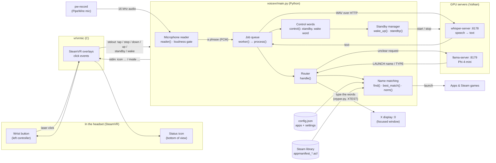
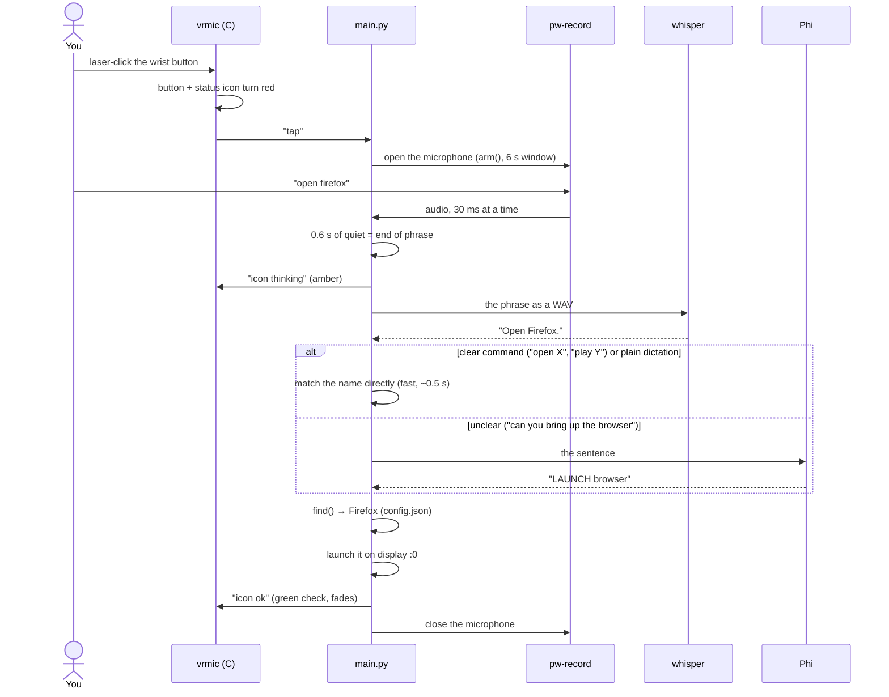
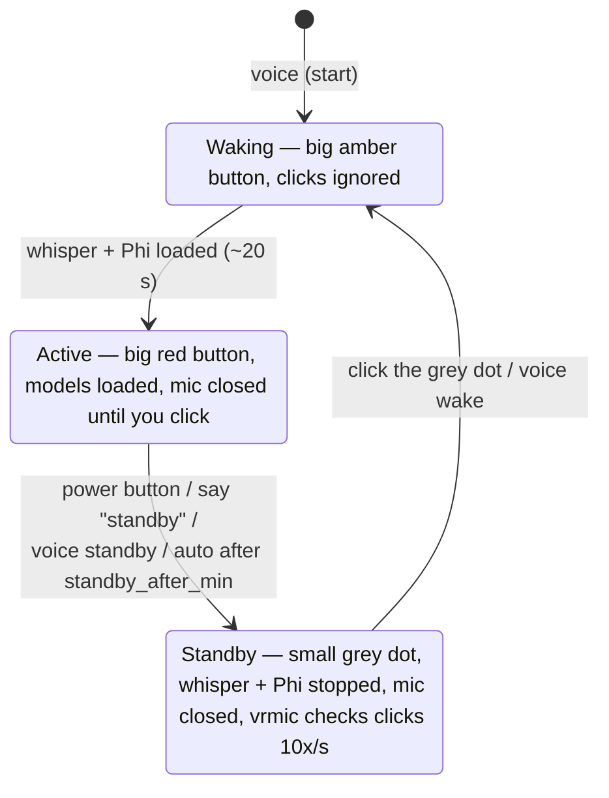

# How FrameVoice works

FrameVoice is made of **one Python program** ([`voicevr/main.py`](../voicevr/main.py)) that runs four helper programs:

| program | language | job |
|---|---|---|
| `vr/vrmic` | C ([`vr/vrmic.c`](../vr/vrmic.c)) | draws the wrist button and status icon in VR and reports clicks |
| `pw-record` | (comes with SteamOS) | the microphone: streams raw audio |
| `whisper-server` | C++ (whisper.cpp) | speech → text, on the GPU |
| `llama-server` | C++ (llama.cpp) running Phi-4-mini | works out unclear requests ("can you bring up the browser"), on the GPU |

`main.py` sits in the middle. It talks to `vrmic` over plain text lines (stdin/stdout), reads the
microphone through a pipe, and calls whisper and Phi over HTTP on `127.0.0.1` (ports 8178 and 8179).

## Block diagram

## What happens when you click and talk

Holding the trigger on the button works the same way. vrmic sends `down` when you have held it for
0.6 s and `up` when you let go, and everything recorded in between is the phrase. No silence detection
is needed.

## Standby

## How the text is turned into an action

[`handle()`](../voicevr/main.py#L551) goes through these steps in order. The first one that fits wins:

1. **Control words** ([`control()`](../voicevr/main.py#L508)): "standby", "go to sleep", or the wake-word on/off phrases.
2. **"type … / write … / dictate …"**: the rest is typed.
3. **No launch word at all** (open, play, start, terminal, browser, …): it's dictation, so it's typed. Phi isn't needed.
4. **"open X" / "play X"**: X is matched against app names, their aliases, then installed Steam
   games ([`find()`](../voicevr/main.py#L533)). A score of 0.8 or more launches it right away.
5. **Anything else**: Phi decides. It may only answer `TYPE` or `LAUNCH <name>` (a grammar forces this,
   so it's quick). The name is then matched with a looser 0.5 score.

Name matching ([`norm()`](../voicevr/main.py#L178), [`best_match()`](../voicevr/main.py#L184)) lower-cases
the names and turns punctuation into spaces. It treats "2", "two" and "II" as the same, then scores names
with Python's `difflib`. It also gives a bonus when what you said is the whole start of a name, so
"half life 2" picks "Half-Life 2: VR Mod".

## The files

| file | what's in it |
|---|---|
| [`voicevr/main.py`](../voicevr/main.py) | everything above. Read it top to bottom: helpers → servers → matching → Phi → launching → the `VoiceVR` class → `main()` |
| [`vr/vrmic.c`](../vr/vrmic.c) | the two SteamVR overlays. One loop: follow the left controller, read clicks, read commands from stdin, sleep 20 ms (100 ms in standby) |
| [`voicevr/xtyper.py`](../voicevr/xtyper.py) | types text into the focused window with X11's XTEST. Each phrase is typed by a short-lived child process, so an X error can't crash FrameVoice |
| [`voicevr/icons.py`](../voicevr/icons.py) | draws the mic / check / X icons as PNGs at startup (pure Python, no image library) |
| [`voicevr/vkeyboard.py`](../voicevr/vkeyboard.py) | alternative typing through a virtual keyboard (`"typing": "uinput"`) |
| [`install.sh`](../install.sh) | builds whisper.cpp, llama.cpp and vrmic, downloads the models, installs `voice` |
| [`run.sh`](../run.sh) | starts `main.py` and writes the log to `~/.cache/voicevr/voicevr.log` |
| [`scripts/voice`](../scripts/voice) | the `voice` command: start / stop / standby / wake / log through a systemd user service |
| [`config.example.json`](../config.example.json) | starting point for your `config.json` |

## Messages between main.py and vrmic

One text line per message.

| direction | message | meaning |
|---|---|---|
| vrmic → main | `tap` | quick click on the button: listen for one phrase |
| vrmic → main | `down` / `up` | trigger held on the button / let go (push to talk) |
| vrmic → main | `stop` | button clicked again while listening: finish the phrase now, or cancel |
| vrmic → main | `standby` | the power button beside it was clicked |
| vrmic → main | `wake` | the grey standby dot was clicked |
| main → vrmic | `icon listening\|thinking\|ok\|fail` | show that state (ok / fail fade after 1.2 s) |
| main → vrmic | `hide` | back to idle |
| main → vrmic | `mode active\|standby\|waking` | button size and colour for standby |
| main → vrmic | `button <image>` | the button's idle image |

If SteamVR restarts, vrmic exits and `main.py` starts it again after 5 s.

## Threads inside main.py

- **main thread**: reads vrmic's messages and calls `arm()`, `start_listening()`, `stop_listening()` or `wake_up()`.
- **reader**: reads microphone audio (only while the mic is open) and cuts it into phrases.
- **worker**: takes one phrase at a time from the queue: whisper → `control()` / `handle()`.
- **watch_state**: every 2 s, picks up `voice standby` / `voice wake` and `./wake.sh on|off`.
- **auto_standby**: every 30 s, checks how long it has been unused (off when `standby_after_min` is 0).
